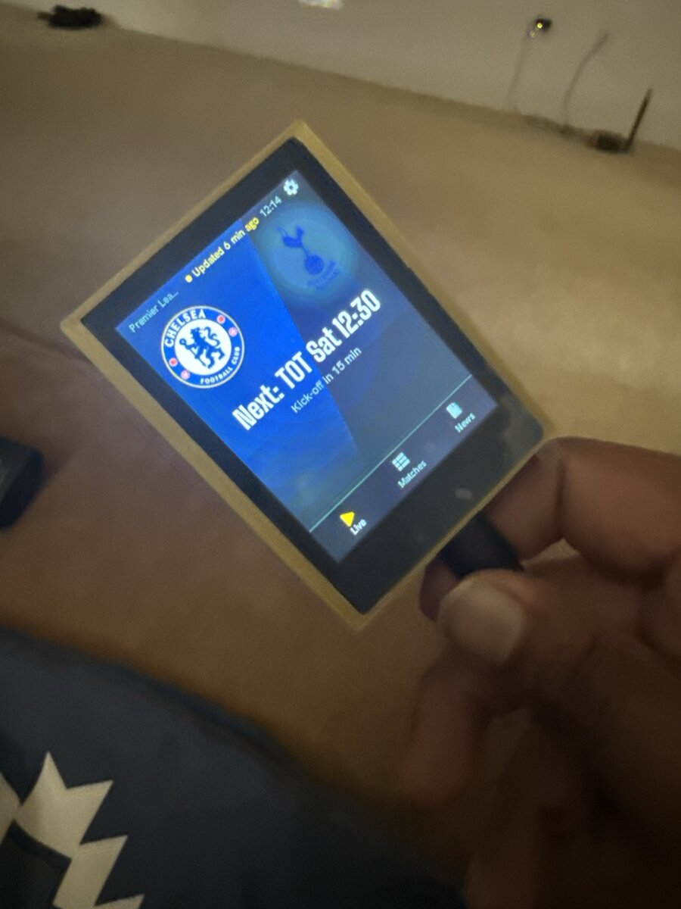
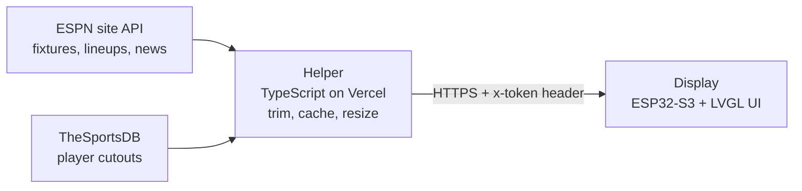
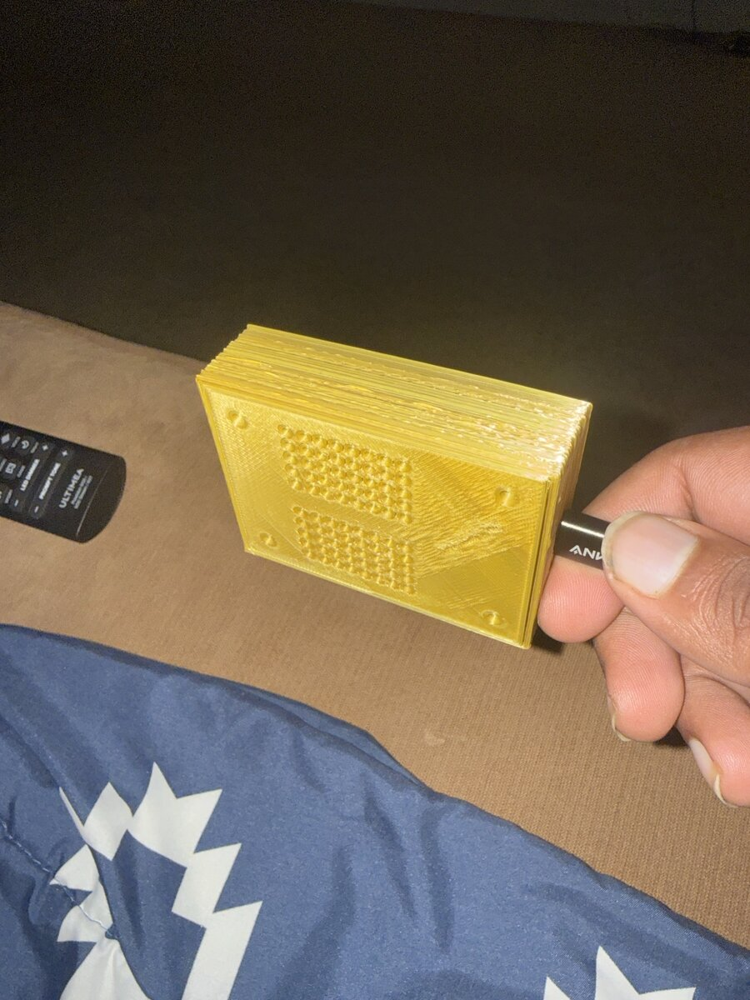
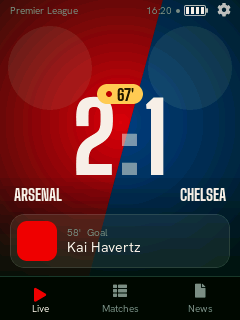
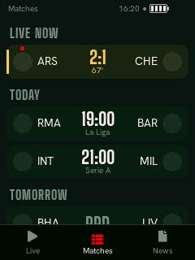
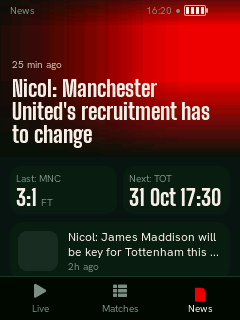
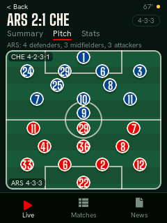
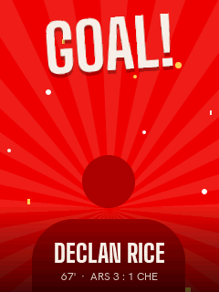
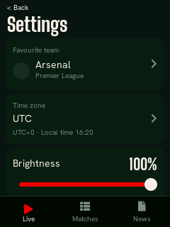

# Soccer Desk Display

A small touchscreen that sits on a desk and shows live football without a phone: the score of your team's match, what is on today, last night's results and a few headlines. It was built as a birthday gift for a friend who follows football but works in places where phones are not allowed.

<p align="center">
  
</p>

The device is a Waveshare ESP32-S3-Touch-LCD-2.8 board running C++ firmware with an LVGL 9 user interface. It never talks to football websites directly. It talks to a small serverless helper (TypeScript on Vercel) that you deploy yourself. The helper fetches public data, trims it, caches it and shrinks the pictures to the sizes the screen needs.

This is a personal, hobby-grade project. It works on the one board it was built on, and the [known limitations](#known-limitations) below are real. Please read them before relying on it.

## What it does

- **Live screen.** Your favourite team's match with the background split in the two team colours, crests, a large score, the match minute and the latest event with the player's face.
- **Matches list.** Live matches pinned on top, then today, tomorrow and yesterday, with a dot on your team.
- **News.** A lead story with a picture, your team's last result and next game, and headline rows with thumbnails.
- **Match detail.** Summary (goals, cards, substitutions), a striped pitch with both starting line-ups and the formation, and stats.
- **Celebrations.** When your team scores the screen floods with its colour, rays turn, "GOAL!" stamps in and the scorer's cutout pops up. A win gets a longer version.
- **Sound.** Synthesized in code, no audio files: an air-horn and crowd swell for a goal, a fanfare for a win, optional whistles at kick-off and full time, soft beeps for a low battery and a chime when Wi-Fi joins. Only your team ever makes a sound. There is a mute-at-night option and a volume setting.
- **Favourite team picker.** Teams from the top five European leagues (Premier League, La Liga, Serie A, Bundesliga, Ligue 1). The choice recolours the whole interface.
- **Wi-Fi setup on the device.** Scan, pick a network, type the password on an on-screen keyboard. Several networks are remembered and the strongest known one is joined automatically (WPA2-Personal and open networks only).
- **Power.** Battery icon, charging indicator and low-battery banners; a power key that turns the screen off and on and powers the board off when held; night dimming that follows a time schedule.
- **Reliability.** Over-the-air updates with rollback, a watchdog, a crash counter that falls back to a safe mode, and a serial console for diagnosis.

## How it works



The device only ever contacts the helper. Reasons: the ESP32 cannot decode or scale large images well, API quirks stay out of the firmware, and the helper can be fixed without reflashing. More detail, with diagrams of the task model, boot, rollback and safe mode, is in [docs/architecture.md](docs/architecture.md).

The user interface in `ui/` is plain C++ with no hardware calls. The same code runs in a PC simulator and on the board, so most of the project can be built, tested and tried without any hardware.

## Hardware

What was actually used for the finished device:

| Part | Used here | Notes |
|---|---|---|
| Board | Waveshare ESP32-S3-Touch-LCD-2.8, V2 revision (SKU 27690) | ESP32-S3R8, 16 MB flash, 8 MB PSRAM, 2.8 in 240x320 ST7789 display, CST3530 touch. Check current price. |
| Battery | 3.7 V 3000 mAh LiPo with protection circuit, 1.25 mm 2-pin JST connector | **Check the polarity before connecting.** See [docs/hardware.md](docs/hardware.md). Check current price. |
| Speakers | Two small speakers on the board's speaker header | Check current price. |
| Cable | USB-C data cable | Used for power, flashing and the serial console. |
| Case | Yellow 3D-printed two-part case with a ventilated back | Design files are not included yet. |

Full pin table, wiring notes and measured results: [docs/hardware.md](docs/hardware.md).

<p align="center">
  
</p>

## Quick start

Pick the path that matches what you want. Step-by-step instructions are in [docs/build-guide.md](docs/build-guide.md).

### 1. Try the simulator (no hardware, no accounts)

Needs cmake, a C++17 compiler, SDL2 and libcurl development packages and a network connection for the first configure (LVGL, ArduinoJson and doctest are fetched).

```sh
git clone https://github.com/YOUR-NAME/YOUR-REPO.git soccer-display
cd soccer-display
cmake -S sim -B build/sim && cmake --build build/sim -j
./build/sim/sim            # demo data, mouse acts as touch
```

Press `g` in the window to make the favourite team score, `w` for a win. See [sim/README.md](sim/README.md) for every option, including headless screenshots.

| Live | Matches | News |
|---|---|---|
|  |  |  |

| Pitch | Goal | Settings |
|---|---|---|
|  |  |  |

The simulator shows demo data with placeholder crests. Optionally, `node sim/assets/fetch.mjs` downloads sample pictures for it onto your machine (needs `npm ci` in `helper/` first). On the device, crests and photos are fetched through the helper at run time.

### 2. Deploy the helper

You need a Vercel account (the free tier was enough for this project) and Node 22 or newer. From `helper/`: link a project, add a `HELPER_TOKEN` environment variable, deploy. Details and a way to make a strong token without ever displaying it are in the [build guide](docs/build-guide.md#3-deploy-the-helper) and in [helper/README.md](helper/README.md).

### 3. Build and flash the firmware

You need PlatformIO and the board. In short:

```sh
cd firmware/app
pio run -e app -t upload                  # first flash over USB-C
./tools/provision-helper.sh --restart     # store helper URL and token on the device
```

Then pick Wi-Fi and your team on the touchscreen. The full walk-through, including how the board enters download mode and what the serial console offers, is in [docs/build-guide.md](docs/build-guide.md).

## Configuration and secrets

- The helper URL and the shared token are written **into the device's NVS flash over the serial console** by `firmware/app/tools/provision-helper.sh`. They are not in the source and not in the firmware image. The script reads the token from a file that must be mode 600 and never prints it, puts it on a command line or leaves it in a log.
- `firmware/app/secrets.ini` is an optional way to bake the URL and token into an image at build time. It is git-ignored and **must never be committed**. An image built with it contains the token and must not be published. `tools/publish-firmware.sh` refuses to run if `secrets.ini` sets them.
- Wi-Fi passwords are stored on the device only and are never logged.
- The token lives unencrypted in the device's flash (see [limitations](#known-limitations)).

## Project layout

```
ui/                 Pure C++ UI library: LVGL screens, store, poller, parsers, sound synth. No hardware calls.
  fonts/            Bitmap fonts generated from Big Shoulders Display and Hanken Grotesk (SIL OFL)
sim/                PC simulator (SDL2) and the doctest suite
firmware/app/       PlatformIO firmware: board drivers, Wi-Fi, HTTPS, OTA, power, watchdog, console
helper/             Serverless helper (TypeScript, Vercel) and its vitest suite
contract/           Recorded API samples (fixtures) that define what the helper returns
tools/              publish-firmware.sh (builds and stages an over-the-air update)
docs/               architecture, hardware, build guide, performance
docs/superpowers/   Design spec, hardware research notes and the firmware plan
```

## Testing

```sh
# UI library and app logic, headless (976 doctest cases)
cmake -S sim -B build/sim && cmake --build build/sim -j
ctest --test-dir build/sim --output-on-failure

# helper (173 vitest cases in 9 files)
cd helper && npm ci && npx vitest run
```

The simulator suite is also run under AddressSanitizer and UBSan; the command is in [sim/README.md](sim/README.md). The only report is a known left shift of a negative value inside LVGL's `lv_draw_sw_gradient.c`. The firmware builds in four PlatformIO environments: `app` (release), `app_diag` (release plus measurement hooks, never flash it onto a device you give away because any serial byte can inject a touch), `app_demo` (built-in demo data) and `app_debug`.

## Performance

Measured on one board, on a desk, over USB power and Wi-Fi, over the serial console. A selection is below; the full tables, methodology and caveats are in [docs/performance.md](docs/performance.md).

| What | Result | Conditions |
|---|---|---|
| `setup()` to first frame on the panel | 1426 ms | `app_diag` build, about 0.45 s more before `setup()` runs |
| Wi-Fi radio ready / joined | 1.9 s / 7.9 s after start | saved network, rssi -61, one 2.6 s scan before the join |
| First matches on screen | 9.7 to 13.9 s after start | depends on the SNTP clock sync |
| Goal celebration | 19.6 to 24.4 fps | live build, frames 35 to 50 ms |
| Swipe Live to Matches | 47 to 62 ms per frame | render bound; SPI alone needs 34 ms per full frame |
| Internal RAM free, idle | 110.8 KB | PSRAM free 7.15 MB |
| Internal RAM lowest, normal start | 65.6 KB | two TLS sessions |

Single board, single desk, single network. These are measurements, not benchmarks, and they are not compared with anything.

## Known limitations

- **The ESPN API is unofficial.** It is public and needs no key, but it can change or disappear without notice. Only the helper depends on it, so a fix does not need a reflash. The design notes name football-data.org as a possible backup source; it is not implemented.
- **TLS does not check certificate dates.** The prebuilt mbedTLS in the Arduino-ESP32 libraries has date checking compiled out. The chain, signature and host name are verified (a self-signed certificate is refused). Turning date checks on would need rebuilding the framework libraries, which was not done. The firmware refuses to make requests until the clock is valid (year 2024 or later).
- **The token is stored unencrypted in NVS.** Flash encryption is not enabled, so anyone with the board and esptool can read it. The release build erases the core dump after printing a summary because a dump could hold the token from RAM.
- **Charging is inferred, not sensed.** The board has no VBUS sense line to a GPIO. Charging is guessed from a sustained rise in battery voltage, so a full pack on USB and a missing battery can look alike.
- **Only the V2 board was tested.** The firmware has a touch driver for the V1 board (CST328) too, but it was never run on V1 hardware.
- **Swipes and long lists are render bound.** Frames take 45 to 70 ms, not smooth at 60 fps. Options for improving this are written up in the performance notes.
- **Unproven on hardware** (from the task reports; see [docs/hardware.md](docs/hardware.md) and [docs/performance.md](docs/performance.md) for detail):
  - the real power-off (GPIO7 low) on battery and on USB, and the real power key feel;
  - battery accuracy against a multimeter, a real drain to the low-battery banner, and charge detection from a low pack;
  - how the sounds actually sound (clicks, hiss, distortion, left/right speaker mapping);
  - a firmware update downloaded over HTTPS from a deployed helper, and a power cut mid-update;
  - a real router power-off or Wi-Fi drop mid-download, and DNS behaviour with the internet down but the router up;
  - kick-off and full-time whistles during a real match;
  - multi-day uptime (the soak test).
- Wi-Fi supports WPA2-Personal and open networks only. Enterprise and captive-portal networks are out of scope.

## Credits and licence

The code in this repository is released under the [MIT licence](LICENSE). Third-party libraries and fonts keep their own licences; see [THIRD_PARTY_NOTICES.md](THIRD_PARTY_NOTICES.md). The fonts Big Shoulders Display and Hanken Grotesk are under the SIL Open Font License 1.1 ([ui/fonts/LICENSE-OFL.txt](ui/fonts/LICENSE-OFL.txt)).

Built on LVGL, ArduinoJson, doctest, Arduino-ESP32 and ESP-IDF, PlatformIO, sharp, Vercel and vitest. Thanks to Waveshare for publishing demo code and schematics that made the board bring-up possible.

## Disclaimer

This is an unofficial, independent project. It is not affiliated with, endorsed by or sponsored by any football club or league, ESPN, TheSportsDB or Waveshare. Club names and crests are trademarks of their owners; they are fetched at run time and no crest or photo is distributed in this repository. A few small recorded API responses are kept in `contract/fixtures` as test data. The project is meant for personal and educational use. If you run a helper, respect the terms of the data providers it contacts and keep your request volume low.
