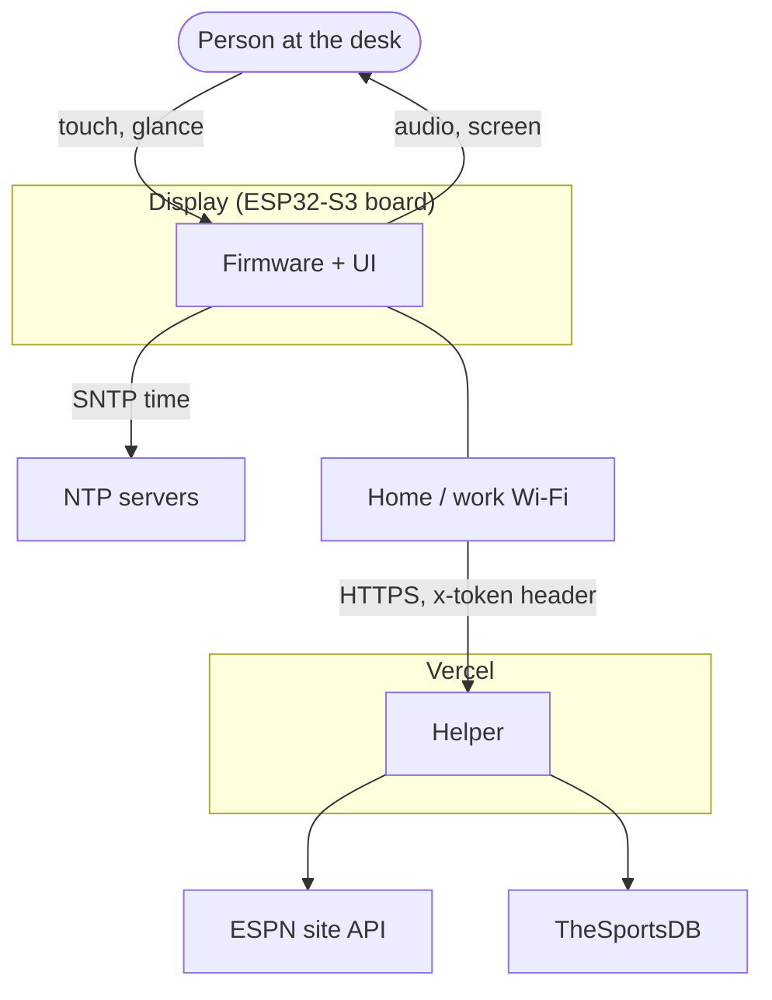
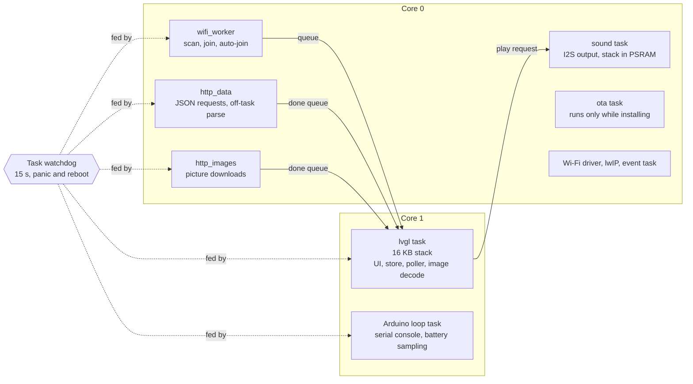
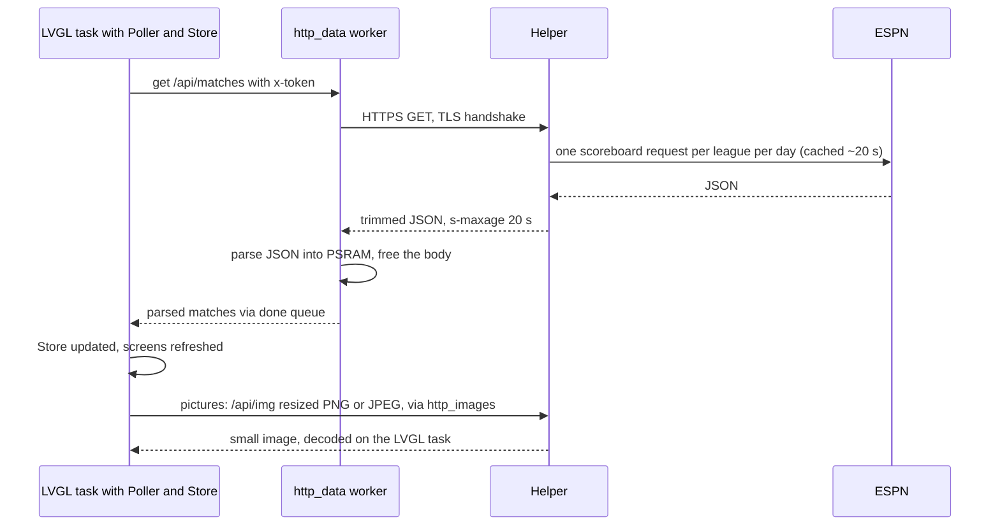
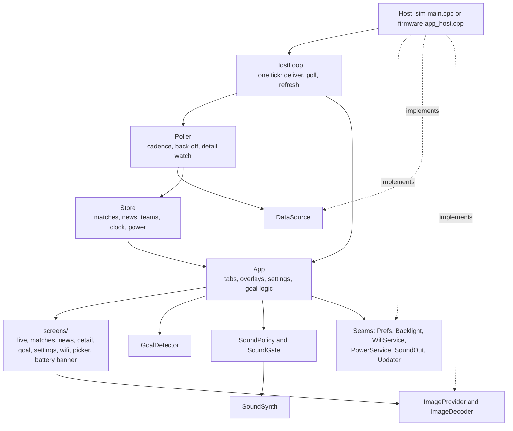
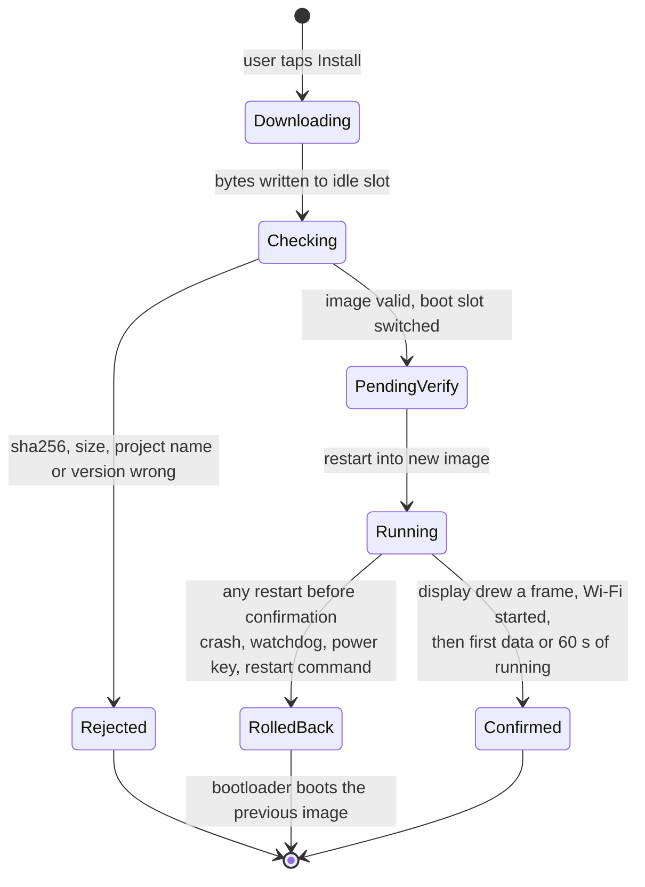
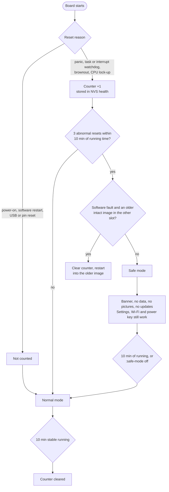

# Architecture

This document explains how the Soccer Desk Display is put together and why. Numbers come from the hardware notes and measurement reports in `docs/superpowers/`; where a statement is a design intent rather than a measurement it says so.

Contents: [Layers](#layers) · [System context](#system-context) · [Task model](#firmware-task-and-thread-model) · [Data flow](#data-flow) · [UI and state modules](#ui-and-state-modules) · [Boot and rollback](#boot-and-ota-rollback) · [Safe mode](#crash-counter-and-safe-mode) · [Design decisions](#key-design-decisions)

## Layers

| Layer | Where | Knows about |
|---|---|---|
| UI library | `ui/` | LVGL, ArduinoJson and the C++ standard library. No hardware, no sockets, no clock reads, no threads. |
| Simulator | `sim/` | SDL2, libcurl, files. Implements the UI's interfaces with mocks and test doubles. Holds the doctest suite. |
| Firmware | `firmware/app/` | ESP-IDF and Arduino-ESP32. Implements the same interfaces on real hardware: display, touch, NVS, Wi-Fi, HTTPS, power, sound, OTA. |
| Helper | `helper/` | ESPN, TheSportsDB, `sharp`. Turns public data into the small JSON and images the device wants. |

The UI talks to the outside world only through small interfaces: `DataSource`, `ImageProvider`/`ImageDecoder`, `Prefs`, `Backlight`, `WifiService`, `PowerService`, `SoundOut` and `Updater`. The simulator and the firmware each provide their own implementations.

## System context

The device contacts exactly two kinds of servers: the helper (over HTTPS, with certificate verification and a shared-token header) and NTP servers for the clock. Firmware updates are also fetched from the helper's own host; the device accepts only an https URL on the helper's host.

## Firmware task and thread model

Only one task, the LVGL task, ever touches LVGL objects or calls into `ui/`. Everything that can block (Wi-Fi, TLS, DNS, flash writes, audio) lives in a worker and hands results back through queues that the LVGL task drains.

Notes:

- LVGL runs on core 1 and Wi-Fi and network work on core 0, as in the vendor demo. The vendor demo reported no Wi-Fi/SPI contention with that split; nothing here contradicts that.
- Stack sizes: LVGL 16 KB, HTTP workers 8 KB, Wi-Fi worker 6 KB. The sound task's stack is in PSRAM because internal RAM is scarce; it never writes flash.
- Finished HTTP requests are delivered only by `poll()`, called from the LVGL task. A request's completion callback is never called from inside `get()`.
- The watchdog is set to 15 s with panic enabled. The OTA download task is deliberately not watched. A connect (DNS, TCP, TLS) is covered by a timer, because lwIP's DNS lookup has no deadline of its own.
- The display flush uses SPI DMA from two internal-RAM draw buffers; a full frame needs about 34 ms on the bus.

## Data flow

Cadence (from `sim/README.md` and the design spec): matches every 25 s while a match is live and every 3 min otherwise, backing off after failures; news every 5 min; the firmware update check about 2 min after start, every 6 h and when Settings opens (at most every 10 min). Nothing installs without a tap on "Install".

Helper endpoints: `/api/health`, `/api/matches`, `/api/match/<id>`, `/api/news`, `/api/teams`, `/api/img`, `/api/cutout`, `/api/firmware/version`. All need the `x-token` header. See [helper/README.md](../helper/README.md) for cache lifetimes, limits and error codes.

## UI and state modules

- `Store` holds the data the screens draw (matches, news, teams, the clock-valid flag, the power state).
- `Poller` owns cadence and back-off. It asks a `DataSource` for data and writes results into the `Store`.
- `HostLoop` is the one sequence both hosts run each tick: deliver finished requests, tell the Poller which match detail is open, tick the Poller, run the once-a-second refresh and refresh after every matches change. While the clock is invalid it does not tick the Poller or refresh the data screens, and instead calls a clockless refresh so the screens read "Waiting for the clock".
- `App` (`app_create`, `app_refresh`) builds the tab view and overlays and applies settings. The `AppDeps` struct lists the optional seams. Without a seam the matching UI simply does not appear (no `WifiService` means no Wi-Fi row; no `SoundOut` means no Sound rows).
- Pure helpers with their own tests: `GoalDetector` (goals, kick-off, full time, with recency guards), `RefreshPolicy`, `BatteryModel`, `DimSchedule`, `WifiStore`, `CrashCounter`, `UpdateFlow`, `RequestDeadline`, `SoundSynth`, `SoundPolicy`.

## Boot and OTA rollback

The flash has two 5 MB app slots, `app0` and `app1`, an `otadata` partition, a 64 KB `nvs` partition and a 64 KB `coredump` partition (see `firmware/app/partitions.csv`).

- The prebuilt bootloader honours `CONFIG_BOOTLOADER_APP_ROLLBACK_ENABLE`. A new image starts in "pending verify" and the bootloader reverts it after a start that does not confirm it.
- The firmware keeps its own trial record in NVS (`ota` / `ota.trial`, at most 3 starts) as a fallback. It never fired on the test board; the bootloader acted first.
- The window is until first successful data or 60 s of running, not a fixed 15 s. Any restart inside the window reverts, including the power key and the console's restart commands.
- The device installs only an image whose SHA-256 (from the token-gated manifest), size (100 KB to 5 MB), project name `soccer-display` and version match.

## Crash counter and safe mode

Running time is measured, not wall-clock time (the clock may be unset): each start adds how long the previous one ran, kept in RTC memory that survives panic, watchdog and software resets. If safe mode comes back soon after leaving, the wait grows (10, 20, 40 then 80 min). Opening the USB serial port resets this board; that is classed as an external reset and is not counted.

## Key design decisions

**A pure `ui/` library with seams.** The UI never calls hardware. That is what lets the same screens run on a PC with SDL and on the board, lets 976 headless tests cover logic that normally needs a device, and lets the simulator take screenshots. The cost is a handful of interfaces to maintain; in return, a hardware problem is almost always in the thin firmware layer and not in the UI.

**One `HostLoop` for both hosts.** The order in which finished requests, polling, detail watching and refresh happen is subtle (clock rules, once-a-second refresh, refresh after data changes). It was extracted out of the simulator's `main.cpp` and shared, so the sequence the tests exercise is the sequence the board runs.

**A helper between device and APIs.** It trims JSON, caches per league and day (ESPN rejects date ranges, so it makes one request per league per day), resizes images to exact pixel sizes and can be fixed without reflashing the device. Requests carry a shared token so strangers cannot use the helper.

**Memory strategy.** Internal RAM is the scarce resource on this board; PSRAM (8 MB) is plentiful.

- The prebuilt mbedTLS is switched at run time to allocate from PSRAM (`mbedtls_platform_set_calloc_free`, installed in `setup()` before Wi-Fi). With TLS in internal RAM the second request failed (`mbedtls_ssl_setup` out of memory).
- All C++ `new` goes to PSRAM (`psram_new.cpp`), and LVGL allocations of 2 KB and above go to PSRAM through allocation hooks.
- JSON documents are built in PSRAM and parsed on the HTTP worker, which also removed a roughly 50 ms hitch from the LVGL task.
- The two SPI draw buffers are internal RAM because DMA needs them there.
- An internal-RAM floor of about 60 KB is kept for TLS and OTA. The image worker waits for about 80 KB free before opening a new TLS connection. The lowest value measured in normal operation is 65.6 KB.

**TLS discipline.** The firmware uses `esp_http_client` over esp-tls and the ESP-IDF certificate bundle, with verification always on (there is no insecure mode), no redirects, and a total deadline per request enforced by a socket watchdog that shuts the socket down at the deadline. Data and pictures use two transports so a data poll never waits behind pictures; the picture transport keeps its connection open between requests (a new handshake cost about 430 ms per picture). The data transport keeps none.

**Off-task work.** JSON parsing is done on the HTTP worker. Picture decoding stays on the LVGL task, at most one per tick, because LVGL's decoder is not thread safe (decodes measured 2 to 40 ms, average 3.2 ms).

**Image pipeline.** The helper resizes each picture to the size the screen shows it at, so the device decodes small PNG or JPEG data and never scales it. The decoded pictures go to a 3 MB PSRAM cache, with a 1.5 KB overhead charged per entry; a picture over 512 KB is refused while it streams in.

**Deadlines everywhere.** Every request has a total time budget; the helper has its own upstream deadlines (5 s per upstream request, 8 s for a matches call), and the device's own limit is 8 s for data and 10 s for pictures.

**Secrets stay out of source and images.** The helper URL and token are provisioned into NVS over the serial console. The release build erases core dumps after printing a summary because a dump could contain the token. A static test checks that log statements never name the token.

**Honest failure states.** Offline, API down or a wrong clock is shown on screen (stale marker, "Waiting for the clock", "No Wi-Fi connection") instead of silently showing old numbers. This follows from an anti-goal in the design spec.
