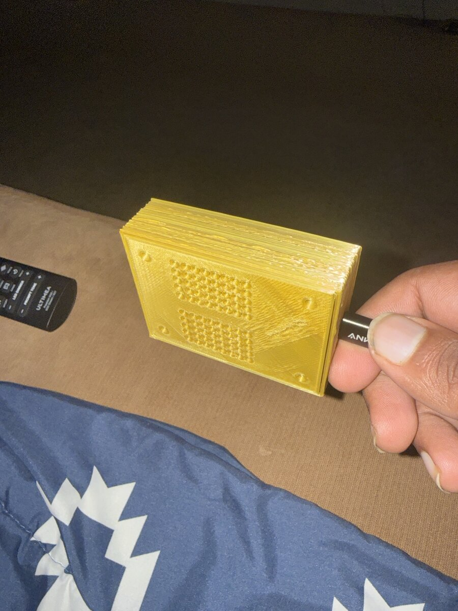

# Hardware

Facts here come from the research and measurement notes in [docs/superpowers/specs/hardware-waveshare-esp32-s3-touch-lcd-2.8.md](superpowers/specs/hardware-waveshare-esp32-s3-touch-lcd-2.8.md), which marks each fact as read from a vendor page, vendor code, a schematic, third-party code, inferred, or measured on the board. Anything not confirmed is labelled here as unverified or inferred.

## Board

Waveshare ESP32-S3-Touch-LCD-2.8, touch version (Waveshare SKU 27690). Not the non-touch ESP32-S3-LCD-2.8.

| Item | Value |
|---|---|
| SoC | ESP32-S3R8 (dual-core Xtensa LX7 up to 240 MHz, 512 KB SRAM, 8 MB co-packaged octal PSRAM) |
| Flash | 16 MB (W25Q128JVSI per the schematic) |
| Display | 2.8 in, 240 x 320 portrait, ST7789 over 4-wire SPI, RGB565, display inversion on |
| Touch | 5-point capacitive over I2C: CST328 on V1, CST3530 on V2 |
| Wireless | 2.4 GHz Wi-Fi (802.11 b/g/n), Bluetooth 5 LE (BLE is not used by this project) |
| Audio | PCM5101A I2S DAC, APA2068 stereo amplifier, speaker header, hardware volume knob |
| Power | USB-C, MX1.25 2-pin LiPo header, ETA6098 charger, PWR key |
| Other on board | QMI8658 IMU, PCF85063 RTC, microSD slot (these three are not used by the firmware) |
| USB | Native ESP32-S3 USB Serial/JTAG on the USB-C port, no USB-UART bridge. Appeared as `/dev/ttyACM0` on the development machine. |

### Two revisions: check yours

Waveshare shipped a V1 board with a CST328 touch chip (I2C address 0x1A) and, since 5 June 2026 per their wiki, a V2 board with a CST3530 (I2C address 0x58). The revision is on a label on the back of the board. The pin assignments are the same on both.

The firmware's touch driver probes for the chip at start-up (CST328 first, then CST3530), so one image is meant to run on both. **Only V2 was ever run.** The CST3530 has no public datasheet; the driver follows the vendor demo code. If you have a V1, treat touch as unverified, and if touch misbehaves, report the revision and the serial console's `[touch]` line.

## Pins used by the firmware

| GPIO | Function |
|---|---|
| 0 | BOOT button (strapping pin; hold at power-up for download mode) |
| 1 | Touch I2C SDA (second I2C bus) |
| 2 | Touch reset |
| 3 | Touch I2C SCL |
| 4 | Touch interrupt |
| 5 | LCD backlight (LEDC PWM, active high; firmware uses 20 kHz, 10 bit) |
| 6 | PWR key input (active low) |
| 7 | Power hold output (drive high to stay powered on battery) |
| 8 | Battery voltage ADC |
| 38 | I2S word select (LRC) |
| 39 | LCD reset |
| 40 | LCD SCLK |
| 41 | LCD DC |
| 42 | LCD CS |
| 45 | LCD MOSI |
| 47 | I2S data out |
| 48 | I2S bit clock |

Not used by the firmware but present: IMU and RTC on I2C (SDA 11, SCL 10), microSD on GPIO 14, 16, 17 and 21, headers for UART (43, 44), USB data (19, 20) and free GPIOs 15 and 18. GPIOs 35 to 37 are used by the octal PSRAM and are not available. The full table with sources is in the hardware notes.

The display runs at 40 MHz SPI. 80 MHz was never tested.

## Bill of materials

Prices are deliberately left out; check current prices from the seller of your choice.

| Part | What was used | Check current price |
|---|---|---|
| Waveshare ESP32-S3-Touch-LCD-2.8 (touch version) | V2 revision | yes |
| LiPo battery, 3.7 V, with protection circuit, 1.25 mm 2-pin connector | 3000 mAh pack (a JLJLUP LP103665 per the project plan) | yes |
| Two small speakers for the board's speaker header | Two small speakers; their exact model and impedance were not recorded (unverified) | yes |
| USB-C data cable | Any data-capable cable. Used for power, flashing and the serial console. | yes |
| 3D-printed case | Yellow, two parts; see below | filament and printing |
| Computer with PlatformIO | For building and flashing | no |

The board's own product page lists an 8 ohm 2 W speaker as included; what you receive may differ.

## Battery wiring: check the polarity first

**Before you connect a battery, check the polarity of the connector with a multimeter.** Waveshare's pages say only "MX1.25 2-pin, 3.7 V" and give no polarity; many third-party LiPo packs use the opposite polarity from the board, and plugging a reversed pack in can destroy the board or the pack.

The user's pack was checked with a multimeter against the board before it was connected. A way to do it:

1. With nothing plugged in, look at the markings next to the board's battery header (silkscreen) and the schematic (net names around the MX1.25 connector and the ETA6098 charger).
2. Measure the pack's connector contacts with the meter set to DC volts (never short the two contacts). A positive reading of about 3.7 to 4.2 V with the red probe on a contact tells you which contact is positive. Do not rely on wire colours.
3. Match pack positive to board positive. If they disagree, re-pin the connector (carefully, one wire at a time, so the leads never touch) or use a different pack.
4. For the first flash, you can leave the battery disconnected (a precaution; it is not from a source).

A pack with a protection circuit is strongly advised. A pack without one is not covered by any of the measurements here.

## Speaker connection

The speaker connector (J9, 1.25 mm, 4-pin per the V1 schematic) carries two separate outputs: left on pins 1 and 2, right on pins 3 and 4. So the board is stereo and can drive one speaker per channel. Whether the V2 board uses the same single 4-pin connector or two 2-pin sockets was not checked; look at your board.

Things worth knowing:

- No ESP32 pin controls the amplifier or the DAC mute. The firmware stops the I2S clock after a clip, but the amplifier stays on, so any hiss it makes on its own is not under firmware control. The volume knob acts in the amplifier, after the DAC, and multiplies with the software volume.
- The firmware sends 16 kHz audio as 16-bit samples in 32-bit slots, so the bit clock is 1.024 MHz, because the DAC derives its system clock from the bit clock.
- Measured over the serial console: every clip ran its full length, with zero DMA underruns across all runs, including during a Wi-Fi scan, a 20-request HTTPS burst and a 30-picture download. That says the driver works. **It says nothing about how it sounds.** Clicks, hiss, distortion and which speaker plays which channel were never checked by ear. Use `:sound tone l` and `:sound tone r` (see the [build guide](build-guide.md)) to check the mapping on your build.

## Power key and power hold

- Pressing the PWR key starts the board from battery. The key pulls the gate of the battery P-MOSFET low directly; GPIO7 then holds it on. The firmware drives GPIO7 high very early in start-up.
- In the firmware: a short press (about 200 ms) turns the screen off or on; holding for about 1 s shows a "Hold to power off" hint; holding for about 3 s powers off (speaker stopped, settings saved, Wi-Fi stopped, GPIO7 low).
- On USB power the board stays powered even with GPIO7 low (from the schematic), so the "off" state on USB is a dark screen with the radio stopped, not a low-power state.
- **The real GPIO7 power-off was never run on hardware.** It was exercised only as a dry run through a diagnostics command. The real key presses were also never made by a person at the bench. See [what to verify](#things-to-verify-on-your-own-board).

## Charging and the battery reading

- Battery voltage is read on GPIO8 through a 1:3 divider. The firmware uses the vendor formula (reading times 3, divided by 0.990476). A multimeter reading of the pack can calibrate it with `:cal-battery <mV>`.
- **There is no VBUS sense line and no charge-status line to the ESP32.** The ETA6098 charger's status pin only drives the red charge LED. The firmware therefore infers charging from a sustained rise in voltage. A flat voltage at or above 4.18 V reads "Full". With no battery connected the board read about 4.18 V (the charger's float voltage), so a full pack and no pack cannot be told apart by voltage.
- The USB serial connection only says that a host is talking to the board, not that external power is present, so it is not used.

Measured on the test board, on USB with the pack connected: 1360 to 1365 mV at the pin, 4119 to 4134 mV by the factory formula, 90 to 93 percent, flat for many minutes. This was not checked against a multimeter, so its accuracy is unknown.

## Enclosure

The photo shows the finished case from the back: a yellow 3D-printed two-part case with a ventilated back that has two patches of speaker grille holes, and an opening for the USB-C cable. Four small holes near the corners of the back are visible. These are the only details taken from the photo; the printing material, dimensions and screw type are not recorded (unverified).

**The design files are not included in this repository yet.** If you design your own case, the vendor structure drawing gives the board outline and mounting holes: PCB 49.90 x 69.00 mm, four mounting holes spaced 41.00 x 60.00 mm, overall thickness 10.00 mm with the LCD stack, touch glass 50.54 x 73.06 mm. The hole diameter could not be read from the drawing (unverified; check against Waveshare's STEP file). The USB-C connector and the speaker and battery connectors are on the bottom edge; the three side buttons and the microSD slot are on the left edge; the volume knob is at the top right of the PCB.

## Measured results

The measurements are collected in [performance.md](performance.md). Hardware-specific results:

| Area | Result |
|---|---|
| Boot, Wi-Fi, frame times, memory | see [performance.md](performance.md) |
| Battery | See above. 90 to 93 percent, reading flat on USB. Not verified against a meter. |
| Task watchdog | 15 s; a deliberate stall reset the board 15.0 s later, listed `wdt_stall` and counted as a crash. |
| Safe mode | Settings, Wi-Fi and the gear tap still work (a gear tap opened Settings in a 152 ms frame); internal RAM free about 131 KB. |
| Audio driver | Zero DMA underruns; says nothing about sound quality. |
| OTA rollback | The bootloader reverted an unconfirmed image as expected. |

## Things to verify on your own board

1. **Touch revision.** Read the label on the back (V1 or V2). Check the `[touch]` line on the serial console at start-up.
2. **Battery polarity** with a multimeter before the first connection (see above).
3. **Battery calibration.** Measure the pack with a multimeter and run `:cal-battery <mV>`; the target is the icon agreeing with the meter within 3 percent.
4. **Real power-off.** On battery only (USB unplugged), hold the PWR key for about 3 s. The board should show "Powering off" and go dark once the key is up. Then check that a key press brings it back. Repeat on USB: the board should stay powered with the backlight at 0.
5. **Speakers.** Listen to every sound, and run `:sound tone l` and `:sound tone r` to see which speaker sounds. Check for clicks, hiss and distortion with the volume knob up.
6. **Backlight and night level.** Use the diagnostics build's `:diag-backlight` sweep to pick a night level you like. The gamma-2.2 curve gives duty 1 of 1024 for 1 to 4 percent, 30 at 20 percent (the default night level) and 223 at 50 percent.
7. **Colours.** Check that the radial gradients and blue halves of similar team colours look right on the real panel (judged by eye only so far).
8. **USB unplug.** Unplug USB and check that the board keeps running on the pack and that the reading drops by the charger's rise.

## Download mode

If the firmware misbehaves and the USB port vanishes, hold BOOT while power cycling the board to force download mode, then flash. Power-cycle again afterwards, because the board does not leave download mode on its own (Waveshare's FAQ). On Linux the serial device is usually `/dev/ttyACM0`; you may need to be in the `dialout` group (Debian, Ubuntu) or `uucp` (Arch, Manjaro).
